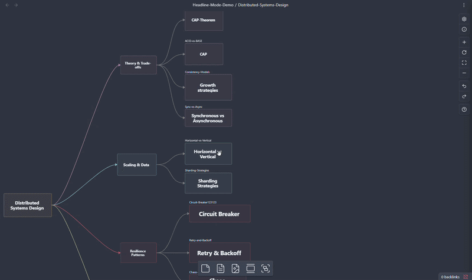

# Canvas Markdown Side Editor

[](https://github.com/ShawnSWu/Obsidian-Canvas-Markdown-Side-Editor/releases)
[](https://github.com/ShawnSWu/Obsidian-Canvas-Markdown-Side-Editor/releases)
[](LICENSE)
[](https://obsidian.md)

Edit Canvas Markdown cards from a side panel — live preview, autosave, and no zooming in and out of cramped cards.



---

## Why this plugin?

Obsidian Canvas is great for visual thinking, but editing Markdown cards directly inside Canvas is cramped — zoom in, double-click a small card, lose context, repeat. Canvas Markdown Side Editor brings a full Obsidian editor next to the Canvas so you can write comfortably without leaving the big-picture view.

> *Write Markdown with the comfort of a full editor, while keeping the big picture in sight.*

## Recommended Setting for Large Canvases

If you often zoom all the way out on the Canvas like I do, I'd recommend turning on "Headline mode" and setting the "Zoom threshold for hiding card content" to the maximum value.
It provides the best overall viewing experience and makes it much easier to navigate large canvases.


---

## Quick Start

1. [Install via BRAT](#option-1--brat-recommended-while-awaiting-obsidian-approval).
2. Open a Canvas in Obsidian.
3. Click any Canvas Text card, or a File card linking to a `.md` file. The side editor opens.
4. Type. Click another card, or the Canvas background, to autosave.

---

## Installation

### Option 1 — BRAT (recommended while awaiting Obsidian approval)

This plugin is currently **awaiting approval in the Obsidian Community Plugins directory**. Until that lands, install via [BRAT](https://github.com/TfTHacker/obsidian42-brat) — it auto-fetches future updates.

https://github.com/user-attachments/assets/82719127-f450-49e9-b99e-b0700451615d

1. In Obsidian: Settings → **Community Plugins** → enable third-party plugins.
2. Settings → **Community Plugins** → **Browse** → search "BRAT" → Install and enable.
3. Settings → **BRAT** → **Add Beta plugin**.
4. Paste the repo URL: `https://github.com/ShawnSWu/Obsidian-Canvas-Markdown-Side-Editor`
5. Confirm. BRAT installs the plugin and pulls updates automatically.

### Option 2 — Community Plugins (once approved)

Settings → **Community Plugins** → **Browse** → search "Canvas Markdown Side Editor" → Install → Enable.

> *Pending Obsidian directory approval.*

### Option 3 — Manual

Download `main.js`, `styles.css`, and `manifest.json` from the latest [Release](https://github.com/ShawnSWu/Obsidian-Canvas-Markdown-Side-Editor/releases) and drop them into `<vault>/.obsidian/plugins/canvas-markdown-side-editor/`. Reload Obsidian and enable the plugin.

---

## Compatibility

- Requires Obsidian `1.1.0` or later.
- Desktop only (`isDesktopOnly: true`).

---

## Troubleshooting

- **Side editor doesn't open** — confirm the card is a Text card, or a File card linking to a `.md` file. Image, PDF, and link cards aren't supported.
- **Headline mode shows an empty card** — that card has no `# H1`. A faint "No headline" placeholder appears so you can spot which cards still need a title.
- **Floating panel opens off-screen after a monitor change** — Settings → reset Dock position to Right, then switch back to Floating.

---

## Changelog

See [GitHub Releases](https://github.com/ShawnSWu/Obsidian-Canvas-Markdown-Side-Editor/releases) for version-by-version notes.

---

## Contributing

Issues and pull requests welcome at [github.com/ShawnSWu/Obsidian-Canvas-Markdown-Side-Editor/issues](https://github.com/ShawnSWu/Obsidian-Canvas-Markdown-Side-Editor/issues).

Local development:

```bash
npm install
npm run dev    # esbuild watch
npm test       # vitest
```

---

## License

MIT — see [LICENSE](LICENSE).
